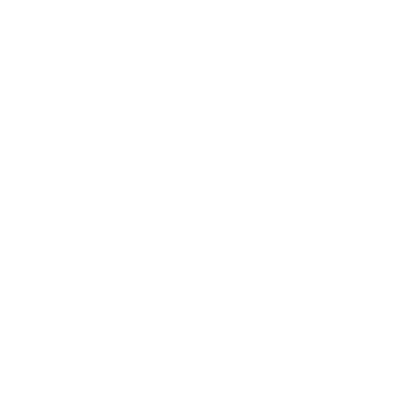

##  xbl1e

Software development portfolio presented as a digital exhibition. Built with Vite, vanilla JavaScript, and CSS.

### &nbsp;&nbsp;Structure

```text
index.html                              # Exhibition, project descriptions, and contact links
src/
├── main.js                             # Page interactions
├── assets/page/                        # Exhibition artwork and favicon
├── components/cards/
│   ├── fieldNotes.js                   # GitHub activity and Discord presence
│   └── projectGrid.js                  # Public repository catalogue
├── styles/main.css                     # Typography, layout, and motion
└── utils/github.js                     # Shared public GitHub repository request
```

### &nbsp;&nbsp;Usage

```bash
npm ci           # install dependencies
npm run dev      # start the development server
npm run build    # build the production site in dist/
npm run preview  # serve the production build locally
```

The catalogue and activity use public endpoints. When an endpoint is unavailable, the page shows a fallback and keeps the profile links accessible.
